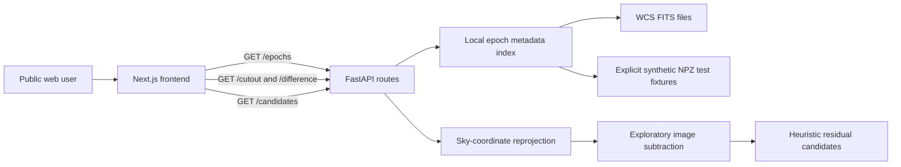

# COSMIC SHIFT v0.2 — technical architecture

## API contract and data integrity

- Each `Epoch` has immutable query ID, date, band, source, target field, approximate center coordinates, units and dataset type (`demo`, `fits`).
- No path input to the server from a browser: cutout IDs are validated against scanned and parsed local file metadata.
- Every cutout is interpolated onto a reference 256×256 sky grid centered on requested ICRS RA/Dec with equal angular field of view.
- FITS files use Astropy's celestial WCS transforms. Synthetic fixtures can use small-angle mapping without Astropy.
- All raw FITS and synthetic NPZ datasets are read locally. **There are no external requests and no SPHEREx archive API endpoint.**
- Strict comparability guards: identical band, `BUNIT`, dataset kind and target field.
- Time-domain thumbnails use shared grayscale limits, computed from all comparable frames.
- Difference images subtract the median background of each aligned image and calculate `B - A`.
- Candidate API uses robust pixel MAD and positive/negative connected components: these are not calibrated probabilities or sigma significances.

## Key future interfaces

`SPHERExArchiveAdapter` (not yet implemented) should provide:

- `search(ra, dec, fov, time_range, band) -> list[Observation]`
- `open(observation) -> image, uncertainty, dq_mask, WCS, calibration_units`
- `provenance(observation) -> archive_url, release, detector_id, calibration_version`

`DifferenceEngine` (needs calibration) should provide:

- `register(inputs, target_WCS)` with coverage/variance weights.
- `match_psf()` and `photometric_scale()` on comparable wavelength channels.
- `subtract()` returning flux residual **and propagated uncertainty**.
- `find_candidates()` with artifact masking and validation, before public reporting.

## Performance / production risks

- Loading full multi-GB mission FITS into worker RAM is not a production solution. Use derived image cutouts, tiling, cache, queues, and object storage.
- The current LRU loader invalidates on file timestamp change; recursive metadata indexing still runs per HTTP request.
- Static CORS is local-development only; configure deployed origins and rate limits.
- Frontend accesses the backend directly; production needs a stable HTTPS API origin and CORS configuration.
- Existing frontend rendering does not provide true Aladin pan/zoom and Gaia overlay; these remain planned.
